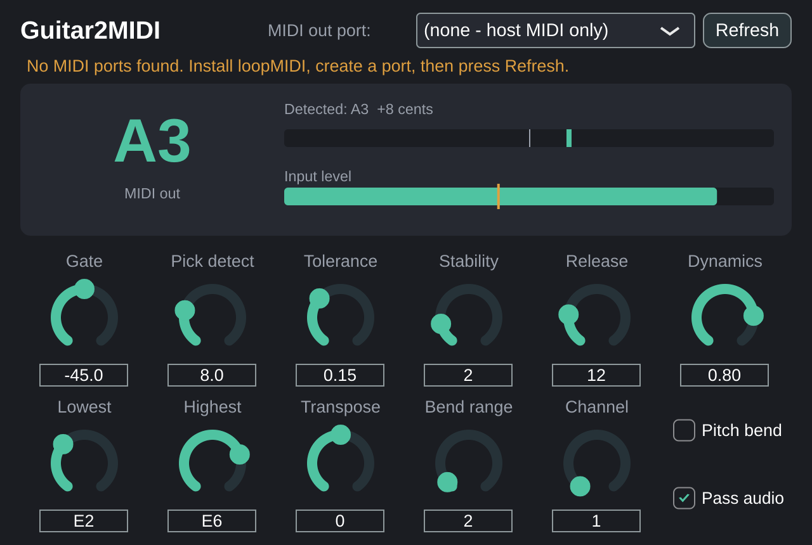

# Guitar2MIDI

VST3-плагин, который в реальном времени превращает звук гитары в MIDI.



- **Установка и настройка в Ableton:** [docs/INSTALL_RU.md](docs/INSTALL_RU.md)
- **Скачать готовый плагин:** вкладка **Actions** → последняя успешная сборка → архив
  `Guitar2MIDI-Windows` внизу страницы.

## Что умеет (версия 0.1)

- Одноголосные мелодии: определение высоты (YIN), атаки медиатора и силы удара (velocity).
- Pitch bend для бендов и вибрато (по желанию).
- Транспонирование, диапазон нот, MIDI-канал.
- Вывод MIDI одновременно в хост и в системный MIDI-порт (loopMIDI). Второй путь
  нужен для Ableton, который не принимает MIDI от аудиоэффектов.
- Встроенный тюнер-индикатор.

## Устройство кода

```
src/dsp/        ядро без зависимостей от JUCE (тестируется отдельно)
  AnalysisTypes.h        общие структуры: кадр анализа (до 6 высот), события нот, настройки
  PitchAnalyzer.*        IPitchAnalyzer + YinPitchAnalyzer (монофонический)
  NoteTracker.*          INoteTracker + MonoNoteTracker (кадры → note on/off/bend)
  GuitarToMidiEngine.*   фильтры, децимация до ~12 кГц, уровень, атаки, связывает всё вместе
src/plugin/     JUCE-плагин: параметры, окно, вывод в MIDI-порт
tests/          EngineTest (синтез струн → проверка нот), HostTest (грузит .vst3 как DAW)
```

### Задел под аккорды

`AnalysisFrame` уже несёт до 6 высот одновременно, по одной на струну. Чтобы добавить
полифонию, достаточно реализовать два класса и переключать их в `GuitarToMidiEngine`:
`PolyPitchAnalyzer : IPitchAnalyzer` (спектральный или нейросетевой, например Basic Pitch)
и `PolyNoteTracker : INoteTracker`, который ведёт по голосу на каждую ноту. Остальной
код (плагин, вывод MIDI, UI) менять не нужно.

## Сборка

Автоматически на GitHub Actions (Windows): каждый push собирает плагин, прогоняет
тесты и проверку pluginval.

Локально (нужны CMake ≥ 3.22 и Visual Studio 2022 или GCC/Clang):

```bash
cmake -B build
cmake --build build --config Release
ctest --test-dir build -C Release
```
